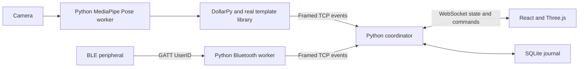

# Runtime architecture

The coordinator is authoritative for the current workspace, context, profile and session. The two independent workers reconnect over loopback TCP, authenticate their event source by connection role, and receive current session and control-epoch context. The vision worker owns the camera and the real-template library. Neither raw camera frames nor queued sensor events cross reconnects.

## Local addresses

- Browser development: `http://127.0.0.1:5173`, Vite proxies `/api` and `/ws`.
- Coordinator HTTP/WebSocket: `127.0.0.1:8000`.
- Worker TCP: `127.0.0.1:8766`, configurable with `DENTAVERSE_TCP_PORT`.
- Isolated browser test ports: UI `5174`, coordinator `8001`, worker TCP `8767`; tests never reuse the workstation.
- Production UI build: `frontend/dist`, served by coordinator when it exists at startup.
- Persistent journal: `data/dentaverse.db` (ignored), configurable with `DENTAVERSE_DB`.
- Pose model: `models/pose_landmarker_lite.task` (ignored).
- Real gesture paths: `data/templates/gestures.json` (ignored).

## Trust and scope

This is a local, single-operator coursework workstation, not an internet service or multi-tenant account system. Bind it to loopback only. Local workers are trusted processes. BLE selects an educational profile and is not an authentication system. The browser cannot impersonate a sensor source. Allowed browser WebSocket origins are the documented localhost development/production origins.

The database assigns ownership from server profile state. Browser actions cannot submit their own role, checkpoints or journal owner. Context content is selected centrally, and each broadcast contains an authoritative state snapshot. The UI disables mutations after disconnect until another snapshot arrives.

## Failure handling

- Worker heartbeat every 5 seconds; framed reads time out after 20 seconds.
- A lost vision worker cancels calibration and pauses gesture mode.
- A recovered landmark stream does not automatically resume the session.
- Each pause, resume and input-mode change increments a control epoch. Captures from an older epoch cannot execute after recovery.
- A BLE read cannot silently replace an active unsaved workspace. The UI requests an explicit save/discard decision.
- Workers discard old pending commands on reconnect and do not buffer failed sensor events.
- Previewing a profile is explicitly manual; only the Bluetooth worker can assert a BLE identification event.

## First-delivery limits

A licensed University of Dundee external molar replaces the procedural placeholder. Runtime mirroring adapts the source's left molar to the right-sided activity; anatomy review and validation of the illustrative internal tissue views remain pending. Manual pointer gestures update the scene immediately and send bounded commands through the same server validation as the sliders. Finger pinch is outside the initial vocabulary; the required camera path uses Pose wrist trajectories, with manual start/stop for deliberate recording. Actual camera trials, BLE peripheral trials, participant research, editable Figma source and faculty asset review require separate evidence in the checklist.
