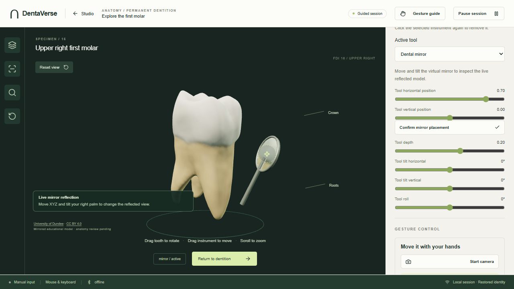
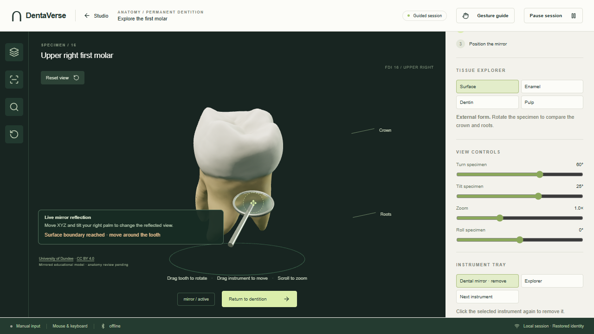
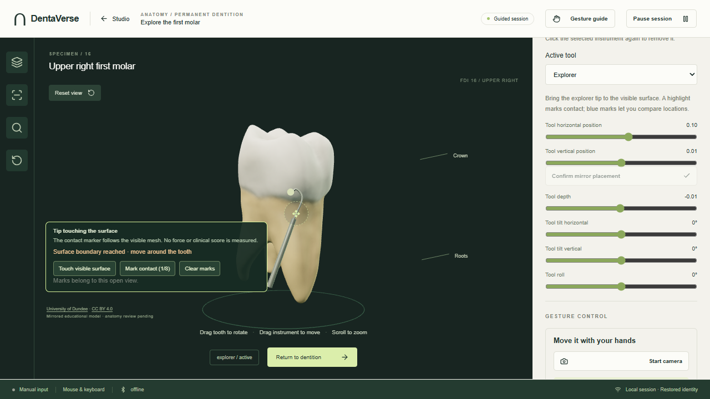

# أدلة واجهة تمت مراجعتها

هذه صور من تشغيل التطبيق الفعلي أثناء اختبارات Edge/Playwright في قاعدة بيانات ومنافذ معزولة. المشهد المرخص هو نفسه المستخدم في الإنتاج. لا توجد بها صور كاميرا لأشخاص أو بيانات مشاركين. مصدر الحركات في اختبار الربط صناعي ومعلن؛ الصور ليست دليلًا على دقة تعرف بشرية أو كفاءة إكلينيكية، ولا تمثل ملف Figma.

## المرآة وانعكاس الموديل

تختبر الحزمة أيضًا بكسلات render target قبل وبعد إزالة جسم مرجعي صناعي؛ وجود لمعان مرسوم وحده لا يُعامل كانعكاس.

## منع التداخل عند الدوران

الموضع المطلوب يقترب من داخل الضرس؛ الرسم يحافظ على حدود الرأس والمقبض خارجه، ويظهر تنبيه الحد. الاختبار يفحص clearance الهندسي بعد تغيّر زاوية الضرس. الحدود تقريبية محافظة ولا تقيس قوى أو وحدات فيزيائية.

## Explorer والملامسة والعلامات

نقطة الملامسة من تقاطع/أقرب سطح الميش؛ العلامة الزرقاء تتبع دوران الموديل في المشهد الحالي. لا تُضاف هذه العلامات المؤقتة إلى سجل المستخدم على أنها ملاحظات محفوظة.

الأصل من University of Dundee ويظهر الإسناد داخل الصور؛ [المصدر والترخيص والتعديلات](../../frontend/public/models/ATTRIBUTION.md). حالات الاختبار ونتائجها في [PROGRESS.md](../../PROGRESS.md).
